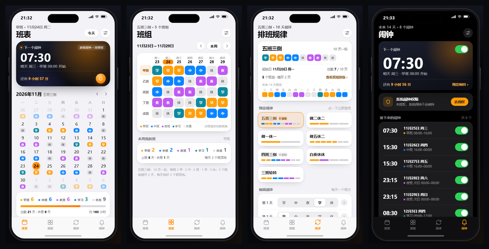

# 班表闹钟

按周期规律自动排班（支持**五班三倒 / 四班三倒**等多班组轮转），并在每个班次开始前用 **iOS 26 系统级闹钟（AlarmKit）** 响铃的排班 App。

仓库里有两部分：

| 目录 | 是什么 | 状态 |
| --- | --- | --- |
| `prototype/` | 可点击的交互原型（单 HTML，Windows 上就能跑） | ✅ 交互已确认 |
| `ShiftAlarm/` | 原生 iOS 工程源码（SwiftUI + AlarmKit，iOS 26） | 🟡 代码已完成，需在 Mac + Xcode 26 上编译验证 |

原型的价值在于把交互和数据规则跑通了；`ShiftAlarm/` 是同一套规则的 Swift 实现，
构建步骤见 [ShiftAlarm/README.md](ShiftAlarm/README.md)。



---

## 一、怎么打开

双击 `prototype/shift-alarm-prototype.html`，用 Chrome / Edge 打开（无需联网、无依赖）。

- 窗口拉大一点，或按 `F11` 全屏，观感最接近真机
- 手机浏览器也能直接访问；地址栏加参数可切换初始状态：
  - `?theme=dark` / `?theme=light` 指定深浅色
  - `?view=crew` / `?view=rule` / `?view=alarms` 直接进对应页
- 建议在 DevTools 里切到 iPhone 15/16 的 390×844 尺寸（页面本身会自动缩放适配）

## 二、可以点什么

| 位置 | 操作 | 会发生什么 |
| --- | --- | --- |
| 月历 | `‹` `›` / 今天 | 切月份、跳回当月 |
| 月历 | 点任意日期 | 弹出当日详情：班次时间、闹钟时间、提前量 |
| 当日详情 | 早/中/晚/休 | 单日改班（成为「手动调整」，日历上显示虚线框，不再跟随规律） |
| 当日详情 | 该日闹钟开关 | 只关掉这一天 |
| 当日详情 | 恢复为循环规律 | 撤销手动调整 |
| 规律页 | 6 个预设 | 做二休二 / 做一休一 / 做五休二 / 四班三倒 / 白夜休休 / 三班轮转，一点即全月重排 |
| 规律页 | 逐天编辑、增删一天、改起始日 | 自定义任意 N 天循环，未来 14 天预览实时更新 |
| **班组页** | 5×7 排班矩阵 | 一屏看完五个班：甲/乙/丙/丁/戊 各自这周哪天早、中、晚、休 |
| **班组页** | 点左侧班组名 | 把「我的排班」切换成该班组视角，月历和闹钟立刻跟着变 |
| **班组页** | `‹` `›` / 本周 | 前后翻周，看别的周的班组排版 |
| **班组页** | 右上角「改名」 | 把甲/乙/丙/丁/戊改成你厂里的叫法（如「白班组」「一号机」），月历、日详情、统计同步更新 |
| 闹钟页 | 大卡片总开关 | 全部闹钟暂停 / 恢复 |
| 闹钟页 | 单条开关 | 关闭某一天的闹钟 |
| 闹钟页 | 去授权 → 允许 / 不允许 | 演示 iOS 系统权限弹窗与三种状态（未授权 / 已授权 / 已拒绝） |
| 闹钟页 | 预览响铃 | 全屏响铃界面（停止 / 稍后提醒 9 分钟） |
| 设置 | 外观、班次开始时间、时长、提前量 | 改完月历与闹钟立刻重算 |
| 设置 | 清除手动调整 | 一键回到纯规律排班 |

## 三、原型里已经跑通的业务规则

1. **周期排班**：`shift = pattern[(date − anchor) mod pattern.count]`
   不是「每周重复」——4 天 / 5 天 / 8 天轮班都能表达，起始日可调。
2. **班组错位**：第 k 个班组把索引再往后推 `k × stride`，
   `stride = 循环天数 ÷ 班组数`（五班三倒 = 10 ÷ 5 = 2 天，四班三倒 = 8 ÷ 4 = 2 天）。
   于是任意一天恰好 3 个班顶岗、其余学习或休息——这条已用自动测试逐日校验。
3. **五班三倒（10 天一轮）**：`学 早 早 中 中 休 夜 夜 休 休`
   每个班每轮 2 早 + 2 中 + 2 夜 + 1 学习 + 3 休；学习班按 09:00–17:00 算一个工作日（08:30 闹钟）。
4. **单日覆盖优先**：手动改过的日期不进规律计算，日历上用虚线框标出；只影响「我」的班组。
5. **闹钟时间 = 班次开始 − 提前量**，可跨零点回退：
   夜班 00:00 开始、提前 45 分钟 → 实际在**前一天 23:15** 响，界面会标「次日 / 前一天」。
6. **三级开关**：总开关 → 班次开关（早/中/夜/学各自是否响）→ 单日开关。
7. **月度统计**：各班天数（含学习）、上班天数、休息天数、总工时。

## 四、转成真 App 的落点

### 1. 页面 → 技术栈

| 原型页面 | SwiftUI 实现 |
| --- | --- |
| 月历 / 规律编辑 | `SwiftUI` + `SwiftData`（`ShiftType` / `ShiftPattern` / `DayOverride`） |
| 闹钟列表 | `AlarmManager.shared.alarms` + `alarmUpdates` 异步序列驱动 |
| 权限卡片 | `AlarmManager.shared.authorizationState` / `requestAuthorization()` / `authorizationUpdates` |
| 响铃界面 | 系统的 AlarmKit 全屏 alert，App 只提供标题、按钮、tint 和 metadata |

### 2. AlarmKit 关键点（iOS 26）

```swift
import AlarmKit

// Info.plist 必须加：NSAlarmKitUsageDescription

// 授权
let state = try await AlarmManager.shared.requestAuthorization()   // .authorized / .denied / .notDetermined

// 一次性闹钟：注意 repeats 只有 .never / .weekly，无法直接表达 4 天轮班
let time = Alarm.Schedule.Relative.Time(hour: 7, minute: 30)
let schedule = Alarm.Schedule.relative(.init(time: time, repeats: .never))

let alert = AlarmPresentation.Alert(
    title: "早班 · 08:00 开始",
    stopButton: .stopButton,
    secondaryButton: .snoozeButton,
    secondaryButtonBehavior: .countdown
)
let attributes = AlarmAttributes(
    presentation: AlarmPresentation(alert: alert),
    metadata: ShiftAlarmMetadata(shiftKey: "morning"),
    tintColor: .orange
)
let config = AlarmManager.AlarmConfiguration(
    countdownDuration: Alarm.CountdownDuration(preAlert: nil, postAlert: 9 * 60),
    schedule: schedule,
    attributes: attributes,
    sound: .default
)
try await AlarmManager.shared.schedule(id: uuid, configuration: config)
```

> 架构上最重要的一条：**因为 `repeats` 只支持 weekly，轮班必须展开成一批「一次性闹钟」**。
> 做法：把未来 14 天的班次展开成 14 个 `.never` 闹钟（上限内），把 `UUID` 存进 SwiftData；
> App 冷启动 / 回前台 / 后台刷新时对比规律，`cancel` 过期与变更的、补排新的。
> 原型闹钟页的「未来 14 天 · N 个闹钟」就是这个策略的界面表达。

### 3. 数据模型草案

```swift
@Model final class ShiftType {
    var key: String          // morning / afternoon / night / study / rest
    var name: String
    var short: String
    var startMinute: Int     // 8*60
    var durationHours: Int   // 8
    var leadMinutes: Int     // 30
    var colorHex: String
    var alarmEnabled: Bool
}

@Model final class ShiftPattern {
    var days: [String]       // 五班三倒：["study","morning","morning","afternoon","afternoon","rest","night","night","rest","rest"]
    var anchor: Date         // 循环起始日
    var crews: Int           // 班组数，1 = 单人排班
    var myCrew: Int          // 我在第几班（0 = 甲班）
    var crewNames: [String]  // 可改名：["白班组","夜班组","丙班","丁班","戊班"]
}

@Model final class DayOverride {
    var date: Date
    var shiftKey: String?    // nil = 未覆盖
    var alarmOff: Bool
}

@Model final class ScheduledAlarm {   // 已排入系统的闹钟，便于增删
    var alarmID: UUID
    var fireDate: Date
    var shiftDate: Date
    var shiftKey: String
}
```

## 五、原生工程（ShiftAlarm/）

```bash
brew install xcodegen
cd ShiftAlarm && xcodegen generate
open ShiftAlarm.xcodeproj     # 选 Team、选 iPhone、Run
```

- 目标：iOS 26 / 真机（模拟器不会真的响铃）
- 数据：`Codable` + `UserDefaults` 本机存储；换 SwiftData + CloudKit 只需替换 `PlanStore`
- 闹钟：未来 14 天展开成一批 `.fixed(Date)` 一次性系统闹钟，改班即重排
- 11 个源文件、约 2000 行，结构见 [ShiftAlarm/README.md](ShiftAlarm/README.md)

## 六、已知风险 / 待确认

- **必须 iOS 26 真机验证**：模拟器测不了静音穿透、专注模式、锁屏响铃。
- **闹钟数量上限**：系统对单 App 的闹钟数有限制，所以只铺 14 天，不是全年。
- **改班即重排**：用户改规律 / 改班次时间后，要立即重算并 cancel+重排，否则会响错。
- **审核**：`NSAlarmKitUsageDescription` 的文案要说清用途；首次申请时机建议放在「用户第一次打开闹钟页」而不是启动即弹。
- **时区 / 跨天**：夜班跨零点已按「前一天晚上响」处理，跨时区旅行暂未处理。

## 七、下一步

1. 在 Mac 上把 `ShiftAlarm/` 编译起来，真机跑通「授权 → 排闹钟 → 到点响」
2. 补 Widget Extension，再加回「稍后提醒 / 锁屏倒计时」
3. 换 SwiftData + CloudKit，换手机也能同步
4. 加「换班」（和同事对调某一天，仅影响两人）
5. 想要给别人装：TestFlight（需要 99 美元/年 的开发者账号）

## 文件

```
README.md                      这份说明
prototype/                     交互原型（Windows 上就能跑）
  shift-alarm-prototype.html   单文件原型，双击即开
  index.html                   本地服务首页（手机访问用）
  screens/                     各页面截图 + overview.png 四屏总览
ShiftAlarm/                    原生 iOS 工程源码（需 Mac + Xcode 26）
  project.yml                  XcodeGen 配置（含 Info.plist 与 NSAlarmKitUsageDescription）
  Sources/                     11 个 Swift 文件：模型 / 排班引擎 / AlarmKit 适配 / 4 个页面
  README.md                    构建步骤、AlarmKit 的三个坑、常见报错
```

页面：排班（我的月历）· 班组（五班矩阵）· 规律（周期编辑）· 闹钟（系统闹钟）

> 原型里的响铃是模拟界面。真实 AlarmKit 的响铃 UI 由系统渲染，App 只能提供标题、按钮文案、tint 与 metadata，外观会与原型略有差异。
